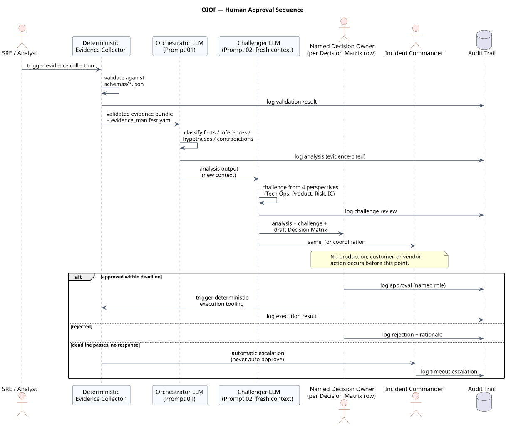

# OIOF — Operational Incident Orchestration Framework

**A reference implementation showing how an LLM can turn fragmented incident evidence into structured, auditable, human-governed decision support, without ever becoming the decision owner.**

[](LICENSE)
[](https://github.com/raskolnikoff/incident-orchestrator-demo/actions/workflows/validate.yml)
[](scripts/validate_dataset.py)
[](#synthetic-data-disclaimer)

> **Everything here is fictional.** The company, incident, systems,
> people, logs, and communications in this repository are synthetic,
> built for this demo. See [Synthetic Data Disclaimer](#synthetic-data-disclaimer).

## Executive summary

Ask an LLM to summarize a pile of incident logs and it will hand you a
confident root cause. That confidence is usually unearned: correlation
quietly becomes causation, three overlapping changes collapse into one,
and a well-written paragraph ends up making a decision nobody approved.

OIOF pushes the other way. It uses an LLM for what it's actually good at
(synthesizing messy evidence, holding several hypotheses at once,
drafting) and leaves every consequential judgment with named humans.

**Not a chatbot demo. Not a log summarizer. Not an autonomous
incident-response bot.**

## Architecture


Evidence moves through normalization, LLM reasoning, an independent
challenge pass, a human decision gate, controlled execution, and an
audit trail. Each stage has a different accountable owner. Full detail:
[`docs/architecture.md`](docs/architecture.md).

## Why this is different from summarization

Fluent prose has a bias toward resolution. "The release caused it" reads
better than "three overlapping changes are each partially supported and
partially contradicted, with no proof for any of them," so a model
optimizing for readability drifts toward the first, even when only the
second is true. Telling a model to "express appropriate uncertainty"
doesn't fix this; that instruction fades over a long context. OIOF
enforces the separation structurally instead:

- Seven required output categories (confirmed facts, evidence-supported
  inferences, competing hypotheses, unresolved questions, missing
  evidence, contradictions, decisions requiring approval), so a claim
  that doesn't fit one has to stay labeled uncertain, not get smoothed over.
- Every meaningful claim cites a stable evidence ID, which makes
  overclaiming mechanically checkable
  (`scripts/validate_examples.py` checks citation resolution and coverage;
  semantic support still requires human review).
- A second model pass, run in a fresh context, challenges the first
  rather than reviewing its own homework.

Full rationale: [`docs/methodology.md`](docs/methodology.md).

## Incident scenario

**Northstar Commerce** (fictional global e-commerce platform):
**Intermittent Checkout Authorization Degradation** across North
America, Europe, and Asia Pacific.

Checkout authorization success fell from a ~97.1% baseline to as low as
~85–88% in NA/EU and ~94% in APAC. Four changes were live in roughly the
same window: a checkout-api release with a more aggressive retry policy,
a CDN cache-policy change, a fraud-rule tightening in EU only, and a
marketing campaign that increased traffic, deployed notably inside
the org's own 24-hour change-freeze window around that campaign (see
`dataset/operating_procedure.md`, §3a). A payment provider vaguely
acknowledged "elevated processing times." Customer complaints span
several unrelated-looking symptoms. **No hypothesis is presented as
conclusively proven**: the dataset is built so more than one cause is
genuinely, simultaneously plausible. Full narrative:
[`dataset/incident_brief.md`](dataset/incident_brief.md).

| | Hypothesis | Illustrative confidence |
|---|---|---|
| **H1** | Payment-provider (ProviderAlpha) latency/timeout degradation | Medium-high for a specific NA/EU window; low overall |
| **H2** | Regression introduced by the checkout-api 3.12.0 release | Low-medium |
| **H3** | EU fraud-rule update causing false declines | Medium for EU contribution; low on false-positive share |
| **H4** | Stale CDN cache for the checkout-config endpoint | Medium for config/rendering errors; low for authorization impact |

Each hypothesis is supported *and* contradicted by different evidence
slices; see [Sample findings](#sample-findings) below.

## Input evidence map

| Source | Records | Evidence IDs |
|---|---|---|
| Application logs (`dataset/application_logs.jsonl`) | 300 | `LOG-APP-001`…`010` |
| API gateway / CDN logs (`dataset/api_gateway_logs.csv`) | 180 | `GW-API-001`…`006` |
| Hourly regional KPIs (`dataset/hourly_kpis.csv`) | 144 | `KPI-HOURLY-001`…`006` |
| Payment metrics (`dataset/payment_metrics.csv`) | 216 | `PAY-METRIC-001`…`006`, `008` |
| Customer feedback (`dataset/customer_feedback.csv`) | 40 | `CS-FEEDBACK-001`…`006` |
| Change records, vendor email, internal chat, campaign schedule, incident history, operating procedure | — | `REL-001`, `CDN-001`, `FRAUD-001`, `VENDOR-001`, `CHAT-001`–`003`, `CAMPAIGN-001`, `HIST-001`, `PROC-001` |

**45 evidence IDs, cataloged in [`dataset/evidence_manifest.yaml`](dataset/evidence_manifest.yaml).**
Every one is cited at least once across `examples/`
([`examples/traceability_matrix.md`](examples/traceability_matrix.md)),
checked automatically by `make validate`.

## Three-stage orchestration workflow

1. **Orchestrate**: [`prompts/01_incident_orchestrator.md`](prompts/01_incident_orchestrator.md)
   synthesizes evidence into facts, inferences, competing hypotheses,
   contradictions, and a draft Decision Matrix. Makes no decision, takes
   no action.
2. **Challenge**: [`prompts/02_independent_challenge.md`](prompts/02_independent_challenge.md)
   critiques that output from four perspectives (Technical Operations,
   Product/Business, Risk & Governance, Incident Commander), ideally in
   a fresh context so it can't just agree with itself.
3. **Decide**: a named human approves, rejects, or defers each Decision
   Matrix row. Only then does anything touch production, a customer, or
   a vendor.

Two further prompts operate downstream of an *approved* decision:
[`prompts/03_automation_blueprint.md`](prompts/03_automation_blueprint.md)
turns it into a human-in-the-loop workflow design, and
[`prompts/04_executive_brief.md`](prompts/04_executive_brief.md)
compresses it into a ~500-word, jargon-free brief.

## Sample findings

From [`examples/orchestrator_analysis.md`](examples/orchestrator_analysis.md):

> Requests routed to ProviderAlpha in NA/EU during 10:00–16:00 UTC show a
> **17.1% timeout rate** (316/1,853), versus a **0% timeout rate** for
> ProviderBeta-routed requests in the same period. **Fact.**
> Evidence: `PAY-METRIC-001`, `PAY-METRIC-002`.
>
> The new release's more aggressive retry policy **may be amplifying**
> load on an already-degraded ProviderAlpha, worsening the apparent
> timeout rate. **Evidence-supported inference.** The two logs aren't
> request-level joined in this dataset, so this is a plausible mechanism,
> not a confirmed link. Evidence: `LOG-APP-007`, `LOG-APP-002`.
>
> Estimated transaction-count shortfall vs. baseline: **~3,046**
> (NA ~1,091, EU ~1,602, APAC ~354). This is a **transaction-count
> estimate**, not a revenue figure. This dataset has no order-value data,
> so no revenue claim is made.

## Decision Matrix preview

From [`examples/decision_matrix.md`](examples/decision_matrix.md) (schema: [`schemas/decision_matrix.schema.json`](schemas/decision_matrix.schema.json)):

| Decision ID | Decision required | Confidence¹ | Reversibility | Decision owner | Status |
|---|---|---|---|---|---|
| `DEC-001` | Roll back checkout-api 3.12.0? | Low | Reversible with effort | Checkout Engineering Lead | Open |
| `DEC-003` | Reroute ProviderAlpha traffic? | Medium | Reversible with effort | Payment Operations Lead | Pending Approval |
| `DEC-004` | Purge CDN cache for `/api/checkout/config`? | High | Easily reversible | SRE Lead | Approved & Executed |

¹ Confidence that the *recommended option* is correct, not confidence in
the underlying hypothesis. `DEC-004` is high-confidence to execute even
though the H4 hypothesis behind it is only medium-confidence, because a
narrow, reversible, low-risk purge is clearly correct regardless.

Note what's absent from `Decision owner`: **no row is ever owned by "AI"
or "the model."** That's enforced at the schema level; see
[Governance principles](#governance-principles).

## Human-in-the-loop workflow



The LLM produces recommendations. Nothing executes until a named human
approves. An unanswered approval deadline **always escalates**; it never
silently auto-approves. Full detail:
[`diagrams/source/human_approval_sequence.puml`](diagrams/source/human_approval_sequence.puml),
[`diagrams/source/escalation_state_machine.puml`](diagrams/source/escalation_state_machine.puml).

## RACI preview

Full table and diagram: [`docs/governance.md`](docs/governance.md).

| Activity | Accountable | Consulted | Informed |
|---|---|---|---|
| Rollback approval | Checkout Engineering Lead | SRE Lead | Incident Commander |
| Fraud-rule change | Fraud Operations Lead | Risk and Governance (conditional) | Incident Commander |
| Incident closure | Incident Commander | All functional leads | Executive Sponsor |

## Repository structure

```
.
├── README.md, LICENSE, CONTRIBUTING.md, CODE_OF_CONDUCT.md,
│   SECURITY.md, CHANGELOG.md, CITATION.cff, Makefile
├── docs/                    architecture, methodology, governance,
│                            limitations, walkthrough, LinkedIn material
├── prompts/                 4 model-agnostic prompts + design notes
├── dataset/                 synthetic evidence set + evidence manifest
├── examples/                6 illustrative example outputs
├── diagrams/
│   ├── source/               6 PlantUML diagrams (editable source)
│   └── rendered/              SVG + PNG output
├── assets/linkedin/
│   ├── source/                3 editable 16:9 carousel SVGs
│   └── rendered/               export, ready to post
├── schemas/                  4 JSON Schemas (evidence, finding,
│                            decision matrix, automation blueprint)
├── scripts/                  dataset generator + validators (stdlib only)
├── tests/                    unittest suite (37 tests)
└── .github/workflows/        validate.yml, render-diagrams.yml
```

## Quick start

```bash
git clone https://github.com/raskolnikoff/incident-orchestrator-demo.git
cd incident-orchestrator-demo

make validate   # dataset integrity + evidence-traceability checks
make test        # unit + integration test suite (37 tests)
make diagrams     # re-render PlantUML sources (requires local PlantUML + Java)
make summary      # compact statistical summary of the dataset
```

No third-party dependencies for `validate` or `test`: Python standard
library only. Full step-by-step tour:
[`docs/walkthrough.md`](docs/walkthrough.md).

## How to use the prompts with any capable LLM

Each file in `prompts/` has a system-role block and a suggested
user-message template. Paste the system block into your model of choice
(the prompts make no vendor-specific assumptions), attach the referenced
evidence files, and run. See
[`prompts/prompt_design_notes.md`](prompts/prompt_design_notes.md) for
context-window tips and guidance on adapting the prompts to your own
incidents.

## Governance principles

> AI should not replace accountability. It should make evidence,
> uncertainty, decisions, ownership, and escalation explicit.

- The LLM synthesizes, classifies, and drafts. It never confirms a
  metric, changes production, notifies a customer, makes a legal
  determination, declares severity, or closes an incident. See the
  automation boundary table in
  [`docs/architecture.md`](docs/architecture.md).
- Every Decision Matrix row has exactly one named human
  `decision_owner`, a schema-level constraint
  ([`schemas/decision_matrix.schema.json`](schemas/decision_matrix.schema.json)),
  not just a convention, with a regression test protecting it
  (`tests/test_schemas.py::test_ai_as_decision_owner_fails`).
- Full RACI, escalation thresholds, and closure criteria:
  [`docs/governance.md`](docs/governance.md).

## Limitations

A design experiment and reference implementation, **not a claim of
production deployment.** No code here calls an LLM API, executes a
production action, or sends a communication. The dataset is small,
curated for analytical richness rather than scale. Full list:
[`docs/limitations.md`](docs/limitations.md).

## Extension ideas

- Real evidence connectors (log/metric backends) behind the same
  evidence-ID abstraction.
- A structured approval UI with deadline countdowns and automated
  escalation, replacing the illustrative checklist-based MVP in
  `examples/automation_blueprint.md`.
- Additional incident archetypes (security incident, data-quality
  incident, slow-burn multi-day degradation) to test how well the
  prompts generalize beyond checkout.
- A model-comparison harness that runs the same prompts across several
  LLMs and diffs the fact/inference/hypothesis classification.
- Request-level trace joining, the single piece of "missing evidence"
  the illustrative analysis flags most often, to test the H1/H2
  amplification hypothesis directly.

## License

[MIT](LICENSE). See [`CITATION.cff`](CITATION.cff) to cite this
repository.

## Synthetic Data Disclaimer

**Everything in this repository is fictional.** Northstar Commerce, all
of its systems (web storefront, mobile app, Checkout API, Payment
Orchestration Service, Fraud Decision Service, Promotion Service, CDN,
observability platform, customer-support platform), "ProviderAlpha,"
"ProviderBeta," and every log, metric, complaint, release note,
fraud-rule change, vendor email, chat message, and operating procedure
are synthetic content built for this demo. No real company, employer,
incident, dataset, person, or internal communication is represented,
referenced, or reproduced anywhere in this repository.
`scripts/validate_dataset.py` runs an automated check against a small
denylist of real organization names as one guardrail among several.
Treat every artifact here as a design illustration, never as a record of
a real event.
