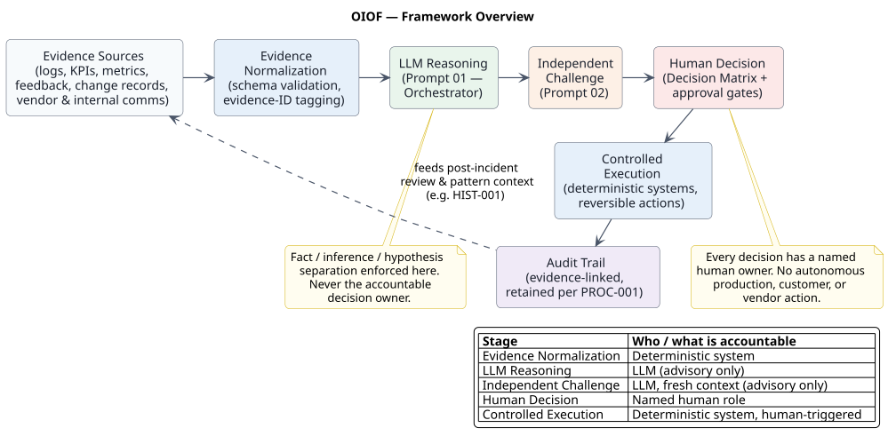
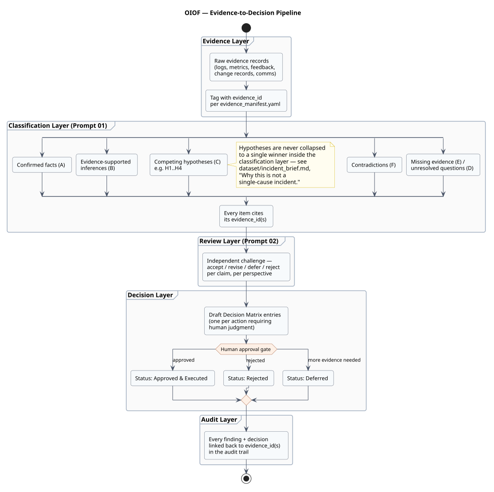

# Architecture

## Overview

OIOF is a pipeline, not a chatbot. Evidence flows through a sequence of
stages, each with a distinct accountability boundary:

```
Evidence Sources → Evidence Normalization → LLM Reasoning →
Independent Challenge → Human Decision → Controlled Execution → Audit Trail
```



Source: `diagrams/source/framework_overview.puml`.

Each arrow in that diagram is a handoff with a different owner:

| Stage | Owner |
|---|---|
| Evidence Normalization | Deterministic system (schema validation, evidence-ID tagging) |
| LLM Reasoning (Prompt 01) | LLM — advisory output only |
| Independent Challenge (Prompt 02) | LLM, fresh context — advisory output only |
| Human Decision | Named human role (Decision Matrix, approval gates) |
| Controlled Execution | Deterministic system, triggered only after human approval |
| Audit Trail | Deterministic system, evidence-linked, retained per `PROC-001` |

## Where the LLM is used

The LLM's role in this framework is bounded to synthesis and drafting
tasks, never to decisions or actions:

- **Evidence synthesis** — organizing raw records from
  `dataset/application_logs.jsonl`, `api_gateway_logs.csv`,
  `hourly_kpis.csv`, `payment_metrics.csv`, and `customer_feedback.csv`
  into a coherent narrative.
- **Uncertainty classification** — sorting claims into confirmed facts,
  evidence-supported inferences, competing hypotheses, contradictions,
  and unresolved questions (`prompts/01_incident_orchestrator.md`).
- **Hypothesis generation** — proposing and evidence-testing multiple
  candidate explanations (H1–H4 in `examples/orchestrator_analysis.md`)
  without collapsing to one.
- **Contradiction detection** — surfacing where two sources disagree
  (`examples/orchestrator_analysis.md`, §5) rather than silently picking
  a side.
- **Decision preparation** — drafting Decision Matrix entries
  (`schemas/decision_matrix.schema.json`) with options, risk ratings, and
  a recommendation — never a decision already made.
- **Workflow drafting** — producing the automation blueprint design
  (`prompts/03_automation_blueprint.md`) as a proposal for human/
  engineering review, not a deployed system.
- **Communication drafting** — producing draft internal and
  customer-facing language, explicitly labeled as pending approval
  (`examples/orchestrator_analysis.md`, §15).

## Where deterministic systems and humans retain responsibility

| Task | LLM-supported | Deterministic system | Human approval required |
|---|---|---|---|
| Evidence collection & schema validation | No | Yes | No |
| Metric calculation (KPI/rate/timeout computation) | No | Yes | No |
| Evidence-ID citation checking | No | Yes | No |
| Hypothesis generation & synthesis | Yes | No | No (informational) |
| Contradiction / confidence assessment | Yes | No | No (informational) |
| Decision Matrix drafting | Yes | No | No (drafting only) |
| Production changes (rollback, reroute, purge) | No | Yes (execution) | Yes, always |
| Access control changes | No | Yes | Yes, always |
| Customer notification | Drafting only | No | Yes, always |
| Legal / regulatory determinations | No | No | Yes, always (Risk & Governance) |
| Financial / revenue impact confirmation | No | Finance systems (outside this repo's scope) | Yes, always |
| Incident severity declaration | No | No | Yes, always (Incident Commander) |
| Incident closure | No | No | Yes, always (Incident Commander) |

This table is the architectural contract: any change to this framework
that would move a row from "human approval required" toward
"LLM-supported" or "deterministic system" for a production, customer,
legal, or closure action is a governance regression, not a feature.

## The four-prompt pipeline

See `prompts/prompt_design_notes.md` for the full rationale. In brief:

1. **`01_incident_orchestrator.md`** synthesizes evidence into the
   structured analysis (facts / inferences / hypotheses / contradictions
   / decisions).
2. **`02_independent_challenge.md`** critiques that analysis from four
   adversarial perspectives, ideally in a fresh context to avoid
   self-rationalization.
3. **`03_automation_blueprint.md`** turns an *approved* analysis into an
   operational workflow design, with explicit human approval gates.
4. **`04_executive_brief.md`** compresses the analysis for a
   non-technical decision-maker.

## Data flow detail



Source: `diagrams/source/evidence_to_decision.puml`. This diagram shows
the internal structure of the "LLM Reasoning" and "Human Decision" stages
from the framework overview: raw evidence is tagged with evidence IDs,
classified into the seven required claim types, challenged, and only
then drafted into Decision Matrix entries that a named human approves,
rejects, or defers.

## Execution and audit

Nothing in this repository executes a production action. The automation
blueprint (`prompts/03_automation_blueprint.md`,
`examples/automation_blueprint.md`) describes how a real deployment would
wire the "Controlled Execution" and "Audit Trail" stages to existing
deterministic tooling (CDN purge APIs, deployment rollback tooling,
payment-routing configuration) — see
`diagrams/source/human_approval_sequence.puml` for the sequence of calls
and `diagrams/source/escalation_state_machine.puml` for how an incident
moves between states, including the escalation paths that trigger when
an approval deadline passes or a decision carries high customer risk.
