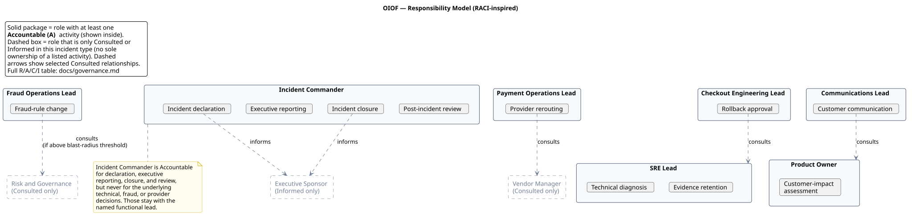

# Governance

## The core principle

> AI should not replace accountability. It should make evidence,
> uncertainty, decisions, ownership, and escalation explicit.

Everything else in this document is an operationalization of that one
sentence.

## The LLM is never the accountable decision owner

This is enforced at three levels, not just stated as a policy:

1. **Prompt level** — `prompts/01_incident_orchestrator.md` and
   `prompts/03_automation_blueprint.md` explicitly prohibit the model
   from taking production, customer, or vendor actions, or from closing
   the incident.
2. **Example level** — every `Decision owner` in
   `examples/decision_matrix.md` is a named human role (Incident
   Commander, SRE Lead, Fraud Operations Lead, etc.), never "AI" or "the
   model."
3. **Schema level** — `schemas/decision_matrix.schema.json` and
   `schemas/automation_blueprint.schema.json` encode this as a `not`
   constraint on the `decision_owner` / `owner_role` / `approver_role`
   fields, and `tests/test_schemas.py` includes a regression test
   (`test_ai_as_decision_owner_fails`) proving an "AI"-owned decision
   fails schema validation.

The schema prohibition is case-insensitive and rejects AI/model tokens
embedded in longer owner labels (for example, "AI system" or "GPT-5
agent"), not only a short exact denylist. This remains a structural
guardrail, not identity proof: a production approval service must resolve
the role to an authenticated human principal and record that principal in
the audit log.

## RACI — incident management activities

Roles: **IC** Incident Commander · **SRE** SRE Lead · **CEL** Checkout
Engineering Lead · **POL** Payment Operations Lead · **FOL** Fraud
Operations Lead · **PO** Product Owner · **CSL** Customer Support Lead ·
**CML** Communications Lead · **RG** Risk and Governance · **ES**
Executive Sponsor · **VM** Vendor Manager

| Activity | IC | SRE | CEL | POL | FOL | PO | CSL | CML | RG | ES | VM |
|---|---|---|---|---|---|---|---|---|---|---|---|
| Incident declaration | **R/A** | C | | | | I | | | | I | |
| Technical diagnosis | C | **R/A** | R | R | R | I | | | | | |
| Customer-impact assessment | C | C | | | | **R/A** | R | | | I | |
| Rollback approval | I | C | **R/A** | | | | | | | | |
| Provider rerouting | I | C | | **R/A** | | | | | | | C |
| Fraud-rule change | I | | | | **R/A** | | | | C | | |
| Customer communication | I | | | | | C | C | **R/A** | | I | |
| Executive reporting | **R/A** | C | C | C | C | C | | | | I | |
| Evidence retention | I | **R/A** | | | | | | | C | | |
| Incident closure | **R/A** | C | C | C | C | C | C | | | I | |
| Post-incident review | **R/A** | C | C | C | C | C | C | C | C | I | |

**Every activity has exactly one Accountable (A) role — no exceptions.**
Where a real organization might reasonably want dual accountability
(e.g. Incident Commander *and* Executive Sponsor both feeling
accountable for executive reporting), this framework deliberately picks
a single accountable role per `PROC-001` to avoid the diffusion of
responsibility that dual-accountability RACI rows tend to produce in
practice. The second role is modeled as Consulted or Informed instead.

A visual (non-exhaustive, illustrative) version of this table:

Source: `diagrams/source/responsibility_model.puml`.

## Escalation thresholds

Per `dataset/operating_procedure.md` (`PROC-001`):

- Any decision with **customer_risk = high** or **reversibility = low**
  requires joint Incident Commander + named functional lead sign-off,
  regardless of declared severity.
- An approval deadline that passes unanswered **always escalates** —
  never auto-approves and never silently expires. This is enforced in
  the illustrative workflow design
  (`examples/automation_blueprint.md`, `timeout_paths`) and in the state
  machine (`diagrams/source/escalation_state_machine.puml`, the
  `Escalated` state).
- Fraud-rule changes below a defined blast-radius threshold may be
  approved by the Fraud Operations Lead alone; above that threshold,
  Risk and Governance sign-off is required.

## Severity and closure are always human decisions

Severity declaration and incident closure are two of the clearest
"human approval required, no LLM/deterministic-system path" rows in the
automation boundary table (`docs/architecture.md`). Closure specifically
requires three conditions per `PROC-001` (§6): authorization metrics
recovered for 2+ consecutive hours, every Decision Matrix entry in a
terminal status, and a post-incident review scheduled — and even when
all three are met, an Incident Commander must still make the closure
call. No workflow design in this repository closes an incident
automatically.

## Consulted vs. Informed, and why the distinction matters

The RACI table above uses Consulted for roles whose input meaningfully
changes a decision before it's made (e.g. SRE Lead consulted on a
checkout-api rollback, since rollback interacts with in-flight retry
behavior) and Informed for roles who need to know a decision was made
but whose input isn't sought beforehand (e.g. the Executive Sponsor
informed of a fraud-rule change). Collapsing this distinction — treating
every stakeholder as "Consulted" — is a common RACI failure mode that
slows decisions down without adding rigor; this framework keeps the
distinction deliberately narrow.
