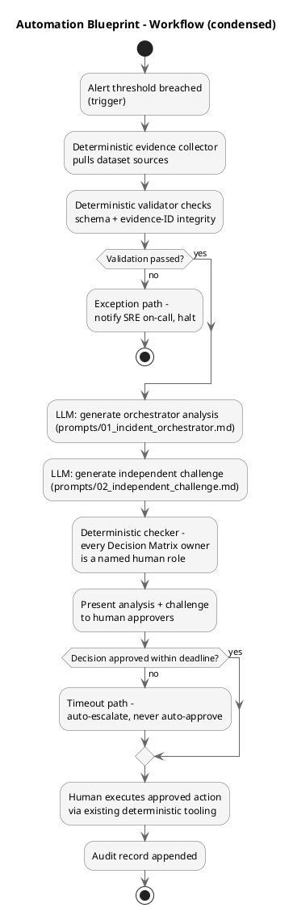
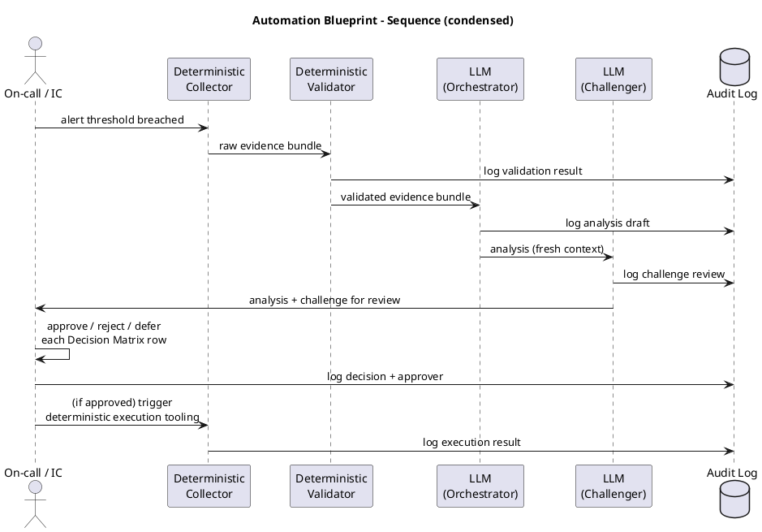

# Illustrative Automation Blueprint — INC-2026-0730-CHECKOUT

> **Illustrative example generated for this synthetic scenario.** Shape
> follows `schemas/automation_blueprint.schema.json`. This document
> designs a human-in-the-loop *workflow*, not an autonomous system —
> every path that touches production, a customer, or a vendor terminates
> in a human approval gate.

## 1. Plain-language workflow

When checkout authorization metrics breach a defined threshold, a
deterministic pipeline gathers the relevant evidence (logs, KPIs,
payment metrics, change records) and hands it to an LLM to produce a
structured orchestrator analysis, in the shape of
`examples/orchestrator_analysis.md`. That analysis is checked against
deterministic rules before any human sees it: does every claim cite a
real evidence ID, does the Decision Matrix name a human owner for every
row. Broken output never reaches a reviewer.

A second LLM pass, run in a fresh context, produces the independent
challenge review. Both documents go to the Incident Commander and the
relevant functional leads together. Nothing in the Decision Matrix
executes until its named owner approves it through an explicit action.
Anything left unapproved past its deadline escalates; it does not
default to action or inaction silently. Every step (evidence pulled,
analysis generated, challenge run, decision approved or rejected, action
taken) is written to an append-only audit log tied to the incident ID.

## 2. PlantUML workflow definition



Full source: `diagrams/source/incident_workflow.puml`.

## 3. PlantUML sequence diagram



Full source: `diagrams/source/human_approval_sequence.puml`.

## 4. State-transition model

`Detected -> Triaged -> Investigating -> Decision Pending -> Contained ->
Monitoring -> Resolved -> Review`, with an `Escalated` state reachable
from `Triaged`, `Investigating`, or `Decision Pending` on timeout or
severity change. See `diagrams/source/escalation_state_machine.puml` for
the full diagram, including guard conditions per transition.

## 5. RACI matrix

See `docs/governance.md` and `diagrams/source/responsibility_model.puml`
for the full incident-wide RACI. The workflow-specific subset:

| Activity | R | A | C | I |
|---|---|---|---|---|
| Run evidence collection | Deterministic system (owned by SRE Lead) | SRE Lead | — | Incident Commander |
| Generate orchestrator analysis | LLM (invoked by SRE Lead or IC) | Incident Commander | Checkout Eng Lead, Payment Ops Lead, Fraud Ops Lead | All functional leads |
| Generate challenge review | LLM (invoked by SRE Lead or IC) | Incident Commander | — | All functional leads |
| Approve a Decision Matrix row | Named decision owner (varies by row) | Named decision owner | Consulted roles per row | Incident Commander |
| Execute an approved action | Owning functional team | Named decision owner | SRE Lead | Incident Commander |
| Append audit record | Deterministic system | SRE Lead | — | Risk and Governance |

## 6. Control register

| Control | What it checks | Owner |
|---|---|---|
| Evidence schema validation | Every collected record validates against its schema before reaching the LLM | SRE Lead |
| Evidence-ID citation check | Every claim in the LLM output cites a real, existing evidence ID | SRE Lead (tooling), Risk and Governance (policy) |
| Decision-owner check | Every Decision Matrix row names a human role, never "AI"/"the model" | Risk and Governance |
| Approval-gate enforcement | No Decision Matrix row can transition to "Approved & Executed" without a logged human approval | Incident Commander |
| Timeout enforcement | Deadlines that pass unanswered escalate automatically; never silently auto-approve or auto-reject | SRE Lead |
| Audit completeness | Every state transition and decision has a corresponding audit record | Risk and Governance |

## 7. Automation boundary table

| Task | LLM-supported | Deterministic system | Human approval required |
|---|---|---|---|
| Evidence collection and normalization | No | Yes | No |
| Schema / evidence-ID validation | No | Yes | No |
| Hypothesis generation and evidence synthesis | Yes | No | No (informational output) |
| Contradiction and confidence assessment | Yes | No | No (informational output) |
| Decision Matrix drafting | Yes | No | No (drafting only) |
| Communication drafting | Yes | No | Yes, before sending |
| Production rollback / config change / reroute / purge | No | Yes (execution) | Yes, always |
| Severity declaration / incident closure | No | No | Yes, always (human judgment call) |
| Audit logging | No | Yes | No |

## 8. MVP backlog

1. Deterministic evidence collector for the five structured dataset
   sources, with schema validation against `schemas/`.
2. Evidence-ID citation checker (`scripts/validate_examples.py` is a
   working prototype of this check).
3. Single LLM call running `prompts/01_incident_orchestrator.md` against
   the validated evidence bundle, output saved to the audit log.
4. Manual (human-run) second LLM call for
   `prompts/02_independent_challenge.md` — full automation of this step
   is future-state, not MVP.
5. A simple approval UI or even a structured approval checklist (could be
   a shared document initially) where named owners mark each Decision
   Matrix row approved/rejected/deferred, logged to the audit trail.
6. Deadline reminders (can be manual/calendar-based in the MVP; automated
   escalation is future-state).

## 9. Risks and mitigations

| Risk | Mitigation |
|---|---|
| Evidence-ID citation check has false negatives (a real claim without a citable ID gets flagged) | Treat the checker as a required-but-not-sufficient gate; a human reviewer can still approve output with a documented exception, logged as such |
| LLM output for the challenge review anchors too heavily on the orchestrator analysis's own framing | Run the challenge in a fresh context/session, not a continuation of the same conversation (see `prompts/prompt_design_notes.md`) |
| Approval deadlines get treated as soft by on-call staff under incident pressure | Timeout path always escalates rather than silently expiring; escalation is visible to the Incident Commander, creating social pressure to respond |
| Audit log becomes incomplete under time pressure | Audit logging is deterministic and automatic at each pipeline step, not a manual step a human could skip |
| Over-automation creep — a future engineer adds an autonomous execution path to "save time" | The automation boundary table (Section 7) and the prohibited-actions list in `prompts/01_incident_orchestrator.md` are the explicit, checkable contract; any change proposal that would automate an execution row requires Risk and Governance review |

---

## Machine-readable summary

```json
{
  "workflow_id": "WF-CHECKOUT-INCIDENT-ORCHESTRATION",
  "triggers": [
    "Automated authorization-success-rate alert breach",
    "Manual analyst request during an active incident"
  ],
  "input_sources": [
    "dataset/application_logs.jsonl",
    "dataset/api_gateway_logs.csv",
    "dataset/hourly_kpis.csv",
    "dataset/payment_metrics.csv",
    "dataset/customer_feedback.csv",
    "dataset/evidence_manifest.yaml"
  ],
  "validation_steps": [
    "Schema validation against schemas/*.json",
    "Evidence-ID citation resolution against evidence_manifest.yaml"
  ],
  "deterministic_checks": [
    "Every Decision Matrix row has a named human decision_owner",
    "Every claim resolves to a real evidence_id",
    "No timeout path defaults to auto-approval"
  ],
  "llm_tasks": [
    "Generate orchestrator analysis (prompts/01)",
    "Generate independent challenge review (prompts/02)",
    "Draft (not send) communications (prompts/01 section 15)"
  ],
  "prohibited_autonomous_actions": [
    "Executing any Decision Matrix row without logged human approval",
    "Sending customer or vendor communication without approval",
    "Declaring, escalating, downgrading, or closing the incident",
    "Auto-approving on timeout"
  ],
  "human_approval_gates": [
    { "gate_name": "Decision Matrix row approval", "approver_role": "Named decision_owner per row", "trigger_condition": "Any row reaching Pending Approval status" },
    { "gate_name": "Communication send approval", "approver_role": "Communications Lead", "trigger_condition": "Any communication draft ready for release" },
    { "gate_name": "Severity / closure decision", "approver_role": "Incident Commander", "trigger_condition": "Any severity change or closure criteria met" }
  ],
  "escalation_conditions": [
    "Approval deadline passes unanswered",
    "New evidence contradicts an already-approved decision",
    "Severity threshold crossed upward"
  ],
  "exception_paths": [
    "Evidence fails schema validation - halt and notify SRE on-call",
    "Evidence-ID citation check fails - return output to LLM step with flagged claims, do not present to human unreviewed"
  ],
  "timeout_paths": [
    "Deadline passes without decision - escalate one level up the reporting line, log as timeout exception, never auto-approve or auto-reject"
  ],
  "rollback_considerations": [
    "Every Decision Matrix option set includes a reversibility rating",
    "Execution tooling for reversible actions (CDN purge, provider reroute) must itself support a documented rollback path before being wired into this workflow"
  ],
  "audit_record_fields": [
    "incident_id", "timestamp", "actor (system or named human role)",
    "action", "evidence_ids_referenced", "decision_id (if applicable)",
    "approval_status"
  ],
  "retention_days": 180,
  "owner_role": "SRE Lead",
  "observability_signals": [
    "Time from trigger to first analysis produced",
    "Time from analysis produced to first human decision",
    "Percentage of Decision Matrix rows with complete evidence citation",
    "Count of timeout escalations per incident"
  ],
  "success_criteria": [
    "Every Decision Matrix row in a closed incident has a named human owner",
    "Zero autonomous production actions across all runs",
    "Median time from trigger to decision-ready analysis under 15 minutes",
    "100% of claims in the analysis resolve to a valid evidence_id"
  ],
  "mvp_scope": [
    "Deterministic collector + validator",
    "Single orchestrator LLM call",
    "Manual second-pass challenge review",
    "Checklist-based approval tracking"
  ],
  "future_state_scope": [
    "Automated second-pass challenge review in an isolated context",
    "Structured approval UI with deadline countdowns and automatic escalation",
    "Direct integration with reversible execution tooling (CDN purge, provider routing) gated on logged approval"
  ]
}
```
